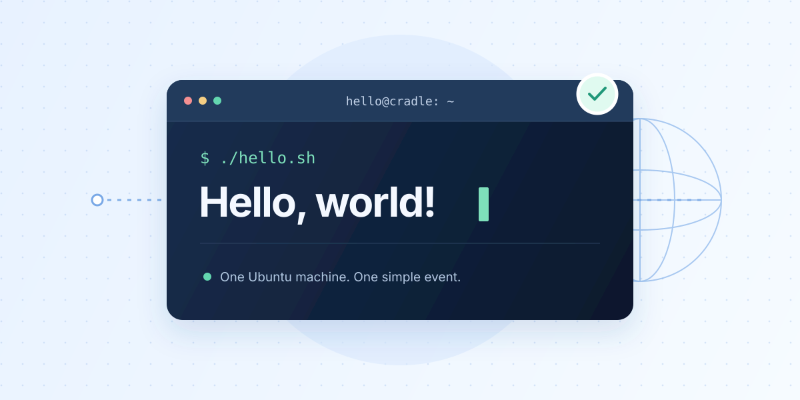

Hello World is a compact end-to-end CRADLE example for beginners. It demonstrates
how to combine scenario-local configurations and heuristics with modules from
the remote `cradle-lib` repository, then run a local object as an event. The
scenario is testbed-independent and has no committed deployment profile.



## What is included

- [HelloWorld.cradle](./HelloWorld.cradle): the scenario specification, including
  its instance, network, module references, and event definition.
- [Local configuration](./configs/hello-world/ansible/hello-world.j2): writes a
  readiness marker during provisioning.
- [Local CVE manifest](./heuristics/cve/CVE-2021-44228/manifest.json) and
  [Ansible template](./heuristics/cve/CVE-2021-44228/ansible/CVE-2021-44228.j2):
  supply the scenario-local `cve/CVE-2021-44228` heuristic.
- [Event object](./objects/artifact/hello.sh): the script run by `mainEvent()`.
- <a href={require('!!file-loader!./README.md').default} download="README.md">README</a>: the original setup and run instructions.
- [Topology preview](./preview.svg): the supplied scenario illustration.

The specification also reuses the `linux-unzip` configuration and the
`cve/CVE-2017-7494` heuristic from remote `cradle-lib`.

## Topology and exercise

One Ubuntu 20.04 instance, `hello`, connects to the private `lan` network
(`10.42.0.0/24`) at `10.42.0.10`.

Provisioning applies the local readiness configuration, the shared unzip
configuration, and both CVE heuristics. The `mainEvent()` phase runs the
`say-hello` event, which executes the local `hello` object with Bash without
requesting root privileges. The specification declares `preEvent()` and
`postEvent()` without additional actions.

The exercise demonstrates module reuse and the provision-to-event workflow.
After provisioning, the guest should contain
`/opt/cradle/hello-world/ready.txt`. Running the event should also create
`/tmp/hello-world-event.txt`.

## Runtime requirements

Install CXC and prepare a backend with an Ubuntu 20.04 image. Create an ignored
`cradle.toml` in this directory to select the deployment target and dependencies.
For Vagrant with libvirt, use:

```toml
name = "HelloWorld"
target = "vagrant"

[backend.vagrant]
provider = "libvirt"

[dependencies]
hello-local = { path = "." }
cradle-lib = { git = "https://github.com/cradle-lang/cradle-lib.git" }
```

For OpenStack, set `target = "openstack"` and add the settings required by that
deployment. Keep deployment credentials outside the committed scenario files.

From this directory, build the scenario:

```bash
cxc build --output build
```

Run the boot, provision, and event commands printed by CXC, then check the two
marker files described above. Both CVE heuristics use Docker images downloaded
during provisioning, so the target VM needs network access at that stage.

[Download the specification](./HelloWorld.cradle).

## Validation evidence

The supplied README documents the build command and expected marker files but
does not record a compiler version, validated source revision, deployment run,
or runtime test results. Compilation, provisioning, and event execution have
not been verified as part of preparing this article. Record those results and
the backend version before publishing the entry.

## Attribution and licensing

This article is based on the scenario's <a href={require('!!file-loader!./README.md').default} download="README.md">README</a> and accompanying
specification. The supplied README does not identify an individual contributor
or state a redistribution license. Confirm attribution and licensing for the
scenario, included assets, and reused `cradle-lib` modules before publication.
